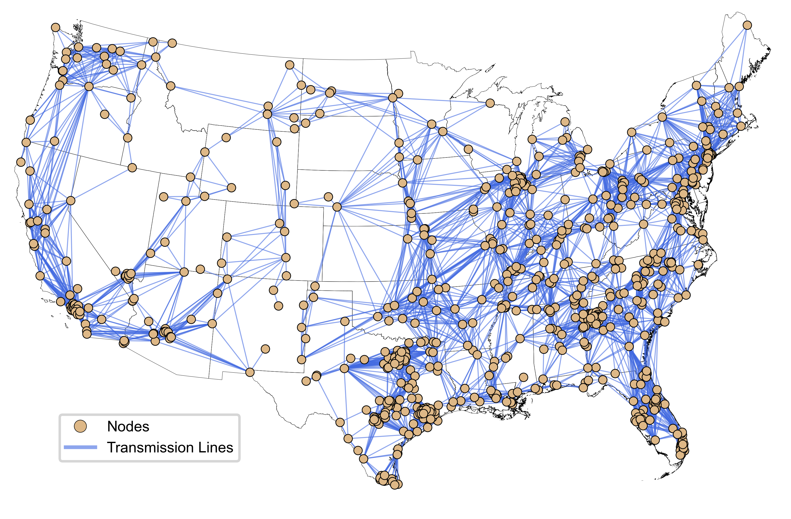

:html_theme.sidebar_secondary.remove:

gridops
=======

.. rst-class:: go-tagline

An open-source, customizable production cost model (PCM) for the U.S. interconnections.

.. rst-class:: go-meta

Version |release| · `Source <https://github.com/IMMM-SFA/gridops>`_ · `Issues and ideas <https://github.com/IMMM-SFA/gridops/issues>`_ · `Reference paper <https://doi.org/10.1088/2753-3751/ad1751>`_

.. code-block:: bash

   pip install gridops

**gridops** is a grid operations model for the three major U.S. interconnections
(Western, Eastern and ERCOT). It uses a linear DC Optimal Power Flow (DC-OPF)
approximation to optimize hourly unit commitment and economic dispatch over a
rolling horizon that you configure. Pyomo builds the model, which can be solved
with the open-source HiGHS solver or with Gurobi.

gridops was created to:

1. Address weather and water dynamics and associated vulnerabilities in U.S. bulk
   power systems.
2. Link with a wide range of hydrometeorological datasets and energy system/machine
   learning models to explore future uncertainty in grid operations.
3. Analyze current and future grid stress and reliability trends under a wide range of
   weather conditions, generation mixes and demand growth scenarios.
4. Create simple and user-tailored representations of the U.S. interconnections that
   balance model accuracy and run time for the research question at hand.

   Reduced transmission network topology represented in gridops.

.. grid:: 1 1 2 2
   :gutter: 3

   .. grid-item-card:: :fas:`rocket` Getting started
      :link: getting_started
      :link-type: doc

      What gridops does, which regions and problem types are available, and how to
      install the package and a solver.

   .. grid-item-card:: :fas:`play` Quickstart
      :link: quickstart
      :link-type: doc

      Run the bundled two-day Western Interconnection example, read the Parquet outputs,
      and plug in your own data.

   .. grid-item-card:: :fas:`book` User guide
      :link: user_guide/index
      :link-type: doc

      Configuration file reference, input data requirements, outputs, the full
      mathematical formulation, rolling-horizon simulation, restarts and solvers.

   .. grid-item-card:: :fas:`code` API reference
      :link: api
      :link-type: doc

      Every public class and function: ``Model``, ``GoSolver``, ``Config``, the restart
      utilities and the Western Interconnection model builder.

How it works
------------

.. grid:: 1 1 3 3
   :gutter: 3

   .. grid-item-card:: 1. Configure

      Point a YAML configuration file at the network, generator, storage, load,
      renewable, hydro, fuel price and outage inputs, and at the output
      destinations.

   .. grid-item-card:: 2. Optimize

      gridops builds one Pyomo DC-OPF model and solves it horizon by horizon. Before
      each solve it updates the time-varying parameters and carries generator output
      and storage state of charge forward.

   .. grid-item-card:: 3. Analyze

      Hourly generator dispatch, line flows, voltage angles, unserved energy,
      locational marginal prices and storage operations are written to Parquet files.

The objective minimizes total system operating cost: fuel and variable O&M costs
for thermal units, plus a large penalty on unserved energy and small tie-breaking
costs on renewables, storage cycling and absolute line flows. The model enforces
nodal power balance, DC power flow, line limits, ramp rates, hydro energy budgets,
renewable availability, forced-outage capacity losses and storage dynamics. See
:doc:`user_guide/formulation` for the equations.

.. toctree::
   :hidden:
   :caption: User documentation

   getting_started
   quickstart
   user_guide/index
   tutorials
   api

.. toctree::
   :hidden:
   :caption: Project

   contributing
   release_notes
   publications
   how_to_cite
   authors
   license
   acknowledgement
